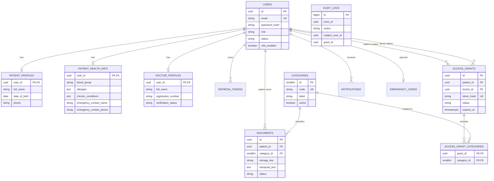

# MedVault: Data Model

> Companion to `SPEC.md` (section 8). Database: **PostgreSQL 15+**, migrations via **Flyway**.
> If this file and `SPEC.md` disagree, stop and resolve it before coding.

---

## 1. Design Decisions

| Decision | Reason |
|---|---|
| **UUID primary keys** (`gen_random_uuid()`) | IDs appear in URLs and QR flows. Sequential IDs are guessable. |
| **`VARCHAR` + `CHECK` instead of Postgres enums** | Adding a value later is a simple migration, not an `ALTER TYPE` headache. |
| **Patient data split into two tables:** `patient_profiles` (identity) and `patient_health_info` (medical) | Enforces "admin cannot see medical data" at the schema level. The admin module only ever maps to identity tables and views. |
| **Admin reads through a database view** (`v_admin_users`) | Even a buggy admin query cannot select a medical column, because the view doesn't have one. |
| **Envelope encryption for files:** each document has its own random data key, wrapped by a master key | Rotating the master key means re-wrapping small keys, not re-encrypting every file. |
| **QR and refresh tokens stored as SHA-256 hashes** | A database leak does not leak usable tokens. |
| **`audit_logs` has no foreign keys and is append-only (trigger)** | Logs must survive account deletion and cannot be edited. |
| **Hard delete for documents** | The patient's right to erasure (DPDP Act). The app also deletes the file from object storage. |

---

## 2. Entity Relationship Diagram



---

## 3. Who Can Read What

This is the most important table in the document. Repositories and DTOs must follow it.

| Table / data | Admin module | Doctor module | Patient module |
|---|:---:|:---:|:---:|
| `users` (email, role, status) | Yes, via `v_admin_users` | Own row only | Own row only |
| `patient_profiles` (name, DOB, phone) | Name only, via view | Name only, during an active grant | Own |
| `patient_health_info` | **Never** | **Never** (MVP) | Own |
| `doctor_profiles` | Yes | Own | Name and specialization of a doctor who claimed a grant |
| `documents` (all columns) | **Never** | Only through the grant check | Own |
| `access_grants` | **Never** (counts only) | Own claimed grants | Own |
| `audit_logs` | Yes (no medical content in it) | No | Rows where `subject_user_id` = self |
| `categories` | Yes (manage) | Read | Read |

---

## 4. Table Reference

### 4.1 `users`
| Column | Type | Notes |
|---|---|---|
| id | uuid PK | |
| email | varchar(255) | Unique, case-insensitive (unique index on `lower(email)`) |
| password_hash | varchar(255) | BCrypt or Argon2 |
| role | varchar(20) | `ADMIN`, `DOCTOR`, `PATIENT` |
| status | varchar(30) | `ACTIVE`, `PENDING_VERIFICATION` (doctors), `SUSPENDED`, `DEACTIVATED` |
| mfa_enabled | boolean | Required for doctor and admin |
| mfa_secret_enc | text | TOTP secret, encrypted at the application level |
| failed_login_count | int | Reset on success |
| locked_until | timestamptz | Temporary lockout |
| last_login_at | timestamptz | |
| created_at, updated_at | timestamptz | |

### 4.2 `patient_profiles` (identity, admin-visible)
`user_id` (PK, FK to users), `full_name`, `date_of_birth`, `gender`, `phone`, timestamps.

### 4.3 `patient_health_info` (medical, admin-blocked)
`user_id` (PK, FK), `blood_group`, `allergies`, `chronic_conditions`, `emergency_contact_name`, `emergency_contact_phone`, `updated_at`.

> This differs slightly from `SPEC.md` section 8, which lists these fields under one `PatientProfile`. Update the spec to match this split.

### 4.4 `doctor_profiles`
`user_id` (PK, FK), `full_name`, `registration_number`, `registration_council`, `specialization`, `license_document_key` (storage key of the uploaded license), `verification_status` (`PENDING`, `APPROVED`, `REJECTED`), `rejection_reason`, `verified_by` (admin user id), `verified_at`, timestamps. Unique on (`registration_council`, `registration_number`).

### 4.5 `categories`
`id` (smallint identity), `code` (unique), `label`, `keywords` (jsonb array used by the rule classifier), `sort_order`, `active`.

### 4.6 `documents`
| Column | Type | Notes |
|---|---|---|
| id | uuid PK | |
| patient_id | uuid FK to users | `ON DELETE CASCADE` |
| category_id | smallint FK | Never null; uncategorized uses the `OTHER` category |
| title | varchar(200) | Defaults to the filename |
| visit_date | date | Optional; drives the timeline |
| doctor_name, hospital_name | varchar(150) | Optional free text |
| original_filename | varchar(255) | Sanitized |
| mime_type | varchar(100) | Detected from content |
| size_bytes | bigint | |
| storage_key | varchar(500) | Object key in MinIO/S3 |
| wrapped_data_key | bytea | Per-file AES key, wrapped by the master key |
| key_version | int | Which master key wrapped it |
| checksum_sha256 | char(64) | Integrity of the plaintext |
| extracted_text | text | OCR result |
| search_vector | tsvector | Generated from title and extracted text, for patient search |
| ocr_confidence | numeric(4,3) | 0.000 to 1.000 |
| classified_by | varchar(10) | `RULES`, `ML`, `USER` |
| status | varchar(15) | `PROCESSING`, `READY`, `FAILED` |
| failure_reason | varchar(255) | Never include document text |
| created_at, updated_at | timestamptz | |

> **Tradeoff to decide:** `extracted_text` is stored as plain text so that the patient can search it with `tsvector`. It is protected by database disk encryption and strict access control. If you later want column-level encryption, you lose database full-text search. For the MVP, plain text with disk encryption is the practical choice.

### 4.7 `access_grants`
| Column | Type | Notes |
|---|---|---|
| id | uuid PK | |
| patient_id | uuid FK | |
| doctor_id | uuid FK, nullable | Null until claimed |
| token_hash | char(64) | SHA-256 of the QR token. Unique |
| status | varchar(10) | `PENDING`, `ACTIVE`, `EXPIRED`, `REVOKED` |
| duration_minutes | int | Initial duration requested |
| total_extended_minutes | int | Running total of extensions |
| claim_expires_at | timestamptz | Deadline for the doctor to scan |
| activated_at | timestamptz | Set on claim |
| expires_at | timestamptz | Set on claim, moved forward by extend |
| revoked_at | timestamptz | |
| revoked_by | uuid | Patient, or the system on suspension |
| created_at | timestamptz | |

Constraints:
- An `ACTIVE` grant must have `doctor_id`, `activated_at`, and `expires_at`.
- `duration_minutes + total_extended_minutes <= 10080` (7 days).

### 4.8 `access_grant_categories`
Composite PK (`grant_id`, `category_id`). `ON DELETE CASCADE` from the grant.

### 4.9 `audit_logs`
| Column | Notes |
|---|---|
| id | bigserial |
| actor_id, actor_role | Who did it (no FK) |
| action | See action list below |
| target_type, target_id | e.g. `DOCUMENT` + id |
| subject_user_id | The patient whose data was involved. Powers the patient's access history |
| grant_id | Related grant if any |
| ip, user_agent | |
| metadata | jsonb, small, **never medical content** |
| created_at | |

Suggested actions: `LOGIN_SUCCESS`, `LOGIN_FAILURE`, `DOCUMENT_UPLOAD`, `DOCUMENT_DELETE`, `DOCUMENT_CATEGORY_CHANGE`, `GRANT_CREATE`, `GRANT_CLAIM`, `GRANT_EXTEND`, `GRANT_REVOKE`, `GRANT_EXPIRE`, `DOCUMENT_VIEW_BY_DOCTOR`, `ACCESS_DENIED`, `DOCTOR_APPROVE`, `DOCTOR_REJECT`, `USER_SUSPEND`, `USER_REACTIVATE`.

### 4.10 Supporting tables
- **`refresh_tokens`**: `id`, `user_id`, `token_hash`, `family_id` (for reuse detection), `expires_at`, `revoked_at`, `replaced_by`, `created_at`.
- **`notifications`**: `id`, `user_id`, `type`, `payload` (jsonb, no medical content), `read_at`, `created_at`.
- **`emergency_cards`** (optional, post-MVP): `patient_id` (PK), `token_hash`, `enabled`, `created_at`.

---

## 5. Redis (ephemeral state, not a source of truth)

| Key | Value | TTL | Purpose |
|---|---|---|---|
| `grant:active:{grantId}` | doctor id + category codes | Until `expires_at` | Fast check on every doctor request. **Postgres stays authoritative.** On a cache miss, check Postgres. |
| `grant:revoked:{grantId}` | `1` | Until original `expires_at` | Instant revoke across API instances |
| `rl:login:{ip}`, `rl:claim:{userId}` | counter | Minutes | Rate limiting |
| `sse:grant:{grantId}` | pub/sub channel | n/a | Live countdown, extend, and revoke events |

Rule: if Redis is unavailable, **fail closed** (deny doctor access) or fall back to Postgres. Never fall back to allowing.

---

## 6. Flyway Migration: `V1__init.sql`

Put this in `backend/src/main/resources/db/migration/V1__init.sql`.

```sql
-- =========================================================
-- V1__init.sql  MedVault initial schema
-- =========================================================

-- ---------- USERS ----------
CREATE TABLE users (
    id                  UUID PRIMARY KEY DEFAULT gen_random_uuid(),
    email               VARCHAR(255) NOT NULL,
    password_hash       VARCHAR(255) NOT NULL,
    role                VARCHAR(20)  NOT NULL,
    status              VARCHAR(30)  NOT NULL,
    mfa_enabled         BOOLEAN      NOT NULL DEFAULT FALSE,
    mfa_secret_enc      TEXT,
    failed_login_count  INT          NOT NULL DEFAULT 0,
    locked_until        TIMESTAMPTZ,
    last_login_at       TIMESTAMPTZ,
    created_at          TIMESTAMPTZ  NOT NULL DEFAULT now(),
    updated_at          TIMESTAMPTZ  NOT NULL DEFAULT now(),
    CONSTRAINT chk_users_role   CHECK (role IN ('ADMIN','DOCTOR','PATIENT')),
    CONSTRAINT chk_users_status CHECK (status IN ('ACTIVE','PENDING_VERIFICATION','SUSPENDED','DEACTIVATED'))
);
CREATE UNIQUE INDEX uq_users_email_lower ON users (lower(email));
CREATE INDEX idx_users_role_status ON users (role, status);

-- ---------- PATIENT IDENTITY (admin-visible) ----------
CREATE TABLE patient_profiles (
    user_id        UUID PRIMARY KEY REFERENCES users(id) ON DELETE CASCADE,
    full_name      VARCHAR(150) NOT NULL,
    date_of_birth  DATE,
    gender         VARCHAR(20),
    phone          VARCHAR(20),
    created_at     TIMESTAMPTZ NOT NULL DEFAULT now(),
    updated_at     TIMESTAMPTZ NOT NULL DEFAULT now()
);

-- ---------- PATIENT MEDICAL INFO (admin must NEVER read) ----------
CREATE TABLE patient_health_info (
    user_id                  UUID PRIMARY KEY REFERENCES users(id) ON DELETE CASCADE,
    blood_group              VARCHAR(5),
    allergies                TEXT,
    chronic_conditions       TEXT,
    emergency_contact_name   VARCHAR(150),
    emergency_contact_phone  VARCHAR(20),
    updated_at               TIMESTAMPTZ NOT NULL DEFAULT now(),
    CONSTRAINT chk_blood_group CHECK (blood_group IS NULL OR
        blood_group IN ('A+','A-','B+','B-','AB+','AB-','O+','O-'))
);

-- ---------- DOCTOR PROFILE ----------
CREATE TABLE doctor_profiles (
    user_id               UUID PRIMARY KEY REFERENCES users(id) ON DELETE CASCADE,
    full_name             VARCHAR(150) NOT NULL,
    registration_number   VARCHAR(50)  NOT NULL,
    registration_council  VARCHAR(100) NOT NULL,
    specialization        VARCHAR(100),
    license_document_key  VARCHAR(500),
    verification_status   VARCHAR(10) NOT NULL DEFAULT 'PENDING',
    rejection_reason      VARCHAR(500),
    verified_by           UUID,
    verified_at           TIMESTAMPTZ,
    created_at            TIMESTAMPTZ NOT NULL DEFAULT now(),
    updated_at            TIMESTAMPTZ NOT NULL DEFAULT now(),
    CONSTRAINT chk_doctor_verification CHECK (verification_status IN ('PENDING','APPROVED','REJECTED')),
    CONSTRAINT uq_doctor_registration UNIQUE (registration_council, registration_number)
);

-- ---------- CATEGORIES ----------
CREATE TABLE categories (
    id          SMALLINT GENERATED ALWAYS AS IDENTITY PRIMARY KEY,
    code        VARCHAR(30)  NOT NULL UNIQUE,
    label       VARCHAR(100) NOT NULL,
    keywords    JSONB        NOT NULL DEFAULT '[]'::jsonb,
    sort_order  INT          NOT NULL DEFAULT 0,
    active      BOOLEAN      NOT NULL DEFAULT TRUE
);

-- ---------- DOCUMENTS ----------
CREATE TABLE documents (
    id                 UUID PRIMARY KEY DEFAULT gen_random_uuid(),
    patient_id         UUID     NOT NULL REFERENCES users(id) ON DELETE CASCADE,
    category_id        SMALLINT NOT NULL REFERENCES categories(id),
    title              VARCHAR(200) NOT NULL,
    visit_date         DATE,
    doctor_name        VARCHAR(150),
    hospital_name      VARCHAR(150),
    original_filename  VARCHAR(255) NOT NULL,
    mime_type          VARCHAR(100) NOT NULL,
    size_bytes         BIGINT NOT NULL,
    storage_key        VARCHAR(500) NOT NULL UNIQUE,
    wrapped_data_key   BYTEA NOT NULL,
    key_version        INT NOT NULL DEFAULT 1,
    checksum_sha256    CHAR(64) NOT NULL,
    extracted_text     TEXT,
    search_vector      TSVECTOR,
    ocr_confidence     NUMERIC(4,3),
    classified_by      VARCHAR(10),
    status             VARCHAR(15) NOT NULL DEFAULT 'PROCESSING',
    failure_reason     VARCHAR(255),
    created_at         TIMESTAMPTZ NOT NULL DEFAULT now(),
    updated_at         TIMESTAMPTZ NOT NULL DEFAULT now(),
    CONSTRAINT chk_doc_status CHECK (status IN ('PROCESSING','READY','FAILED')),
    CONSTRAINT chk_doc_classified_by CHECK (classified_by IS NULL OR classified_by IN ('RULES','ML','USER')),
    CONSTRAINT chk_doc_confidence CHECK (ocr_confidence IS NULL OR (ocr_confidence >= 0 AND ocr_confidence <= 1)),
    CONSTRAINT chk_doc_size CHECK (size_bytes > 0)
);
CREATE INDEX idx_documents_patient_category ON documents (patient_id, category_id);
CREATE INDEX idx_documents_patient_visit    ON documents (patient_id, visit_date DESC NULLS LAST);
CREATE INDEX idx_documents_search           ON documents USING GIN (search_vector);

CREATE FUNCTION documents_search_vector_update() RETURNS trigger AS $$
BEGIN
    NEW.search_vector :=
        setweight(to_tsvector('simple', coalesce(NEW.title, '')), 'A') ||
        setweight(to_tsvector('simple', coalesce(NEW.extracted_text, '')), 'B');
    RETURN NEW;
END;
$$ LANGUAGE plpgsql;

CREATE TRIGGER trg_documents_search_vector
    BEFORE INSERT OR UPDATE OF title, extracted_text ON documents
    FOR EACH ROW EXECUTE FUNCTION documents_search_vector_update();

-- ---------- ACCESS GRANTS ----------
CREATE TABLE access_grants (
    id                      UUID PRIMARY KEY DEFAULT gen_random_uuid(),
    patient_id              UUID NOT NULL REFERENCES users(id) ON DELETE CASCADE,
    doctor_id               UUID REFERENCES users(id) ON DELETE SET NULL,
    token_hash              CHAR(64) NOT NULL UNIQUE,
    status                  VARCHAR(10) NOT NULL DEFAULT 'PENDING',
    duration_minutes        INT NOT NULL,
    total_extended_minutes  INT NOT NULL DEFAULT 0,
    claim_expires_at        TIMESTAMPTZ NOT NULL,
    activated_at            TIMESTAMPTZ,
    expires_at              TIMESTAMPTZ,
    revoked_at              TIMESTAMPTZ,
    revoked_by              UUID,
    created_at              TIMESTAMPTZ NOT NULL DEFAULT now(),
    CONSTRAINT chk_grant_status CHECK (status IN ('PENDING','ACTIVE','EXPIRED','REVOKED')),
    CONSTRAINT chk_grant_duration CHECK (duration_minutes > 0),
    CONSTRAINT chk_grant_total_cap CHECK (duration_minutes + total_extended_minutes <= 10080),
    CONSTRAINT chk_grant_active_fields CHECK (
        status <> 'ACTIVE' OR (doctor_id IS NOT NULL AND activated_at IS NOT NULL AND expires_at IS NOT NULL)
    )
);
CREATE INDEX idx_grants_patient_status ON access_grants (patient_id, status);
CREATE INDEX idx_grants_doctor_status  ON access_grants (doctor_id, status);
CREATE INDEX idx_grants_expiry         ON access_grants (expires_at) WHERE status = 'ACTIVE';
CREATE INDEX idx_grants_pending_claim  ON access_grants (claim_expires_at) WHERE status = 'PENDING';

CREATE TABLE access_grant_categories (
    grant_id     UUID     NOT NULL REFERENCES access_grants(id) ON DELETE CASCADE,
    category_id  SMALLINT NOT NULL REFERENCES categories(id),
    PRIMARY KEY (grant_id, category_id)
);

-- ---------- AUTH SUPPORT ----------
CREATE TABLE refresh_tokens (
    id           UUID PRIMARY KEY DEFAULT gen_random_uuid(),
    user_id      UUID NOT NULL REFERENCES users(id) ON DELETE CASCADE,
    token_hash   CHAR(64) NOT NULL UNIQUE,
    family_id    UUID NOT NULL,
    expires_at   TIMESTAMPTZ NOT NULL,
    revoked_at   TIMESTAMPTZ,
    replaced_by  UUID,
    created_at   TIMESTAMPTZ NOT NULL DEFAULT now()
);
CREATE INDEX idx_refresh_user   ON refresh_tokens (user_id);
CREATE INDEX idx_refresh_family ON refresh_tokens (family_id);

-- ---------- NOTIFICATIONS ----------
CREATE TABLE notifications (
    id          UUID PRIMARY KEY DEFAULT gen_random_uuid(),
    user_id     UUID NOT NULL REFERENCES users(id) ON DELETE CASCADE,
    type        VARCHAR(40) NOT NULL,
    payload     JSONB NOT NULL DEFAULT '{}'::jsonb,
    read_at     TIMESTAMPTZ,
    created_at  TIMESTAMPTZ NOT NULL DEFAULT now()
);
CREATE INDEX idx_notifications_user_unread ON notifications (user_id, created_at DESC) WHERE read_at IS NULL;

-- ---------- AUDIT LOG (append-only, no FKs on purpose) ----------
CREATE TABLE audit_logs (
    id               BIGSERIAL PRIMARY KEY,
    actor_id         UUID,
    actor_role       VARCHAR(20),
    action           VARCHAR(50) NOT NULL,
    target_type      VARCHAR(30),
    target_id        UUID,
    subject_user_id  UUID,
    grant_id         UUID,
    ip               VARCHAR(45),
    user_agent       VARCHAR(255),
    metadata         JSONB NOT NULL DEFAULT '{}'::jsonb,
    created_at       TIMESTAMPTZ NOT NULL DEFAULT now()
);
CREATE INDEX idx_audit_subject ON audit_logs (subject_user_id, created_at DESC);
CREATE INDEX idx_audit_actor   ON audit_logs (actor_id, created_at DESC);
CREATE INDEX idx_audit_grant   ON audit_logs (grant_id);
CREATE INDEX idx_audit_action  ON audit_logs (action, created_at DESC);

CREATE FUNCTION prevent_audit_mutation() RETURNS trigger AS $$
BEGIN
    RAISE EXCEPTION 'audit_logs is append-only';
END;
$$ LANGUAGE plpgsql;

CREATE TRIGGER trg_audit_no_update_delete
    BEFORE UPDATE OR DELETE ON audit_logs
    FOR EACH ROW EXECUTE FUNCTION prevent_audit_mutation();

-- ---------- ADMIN VIEW (the ONLY thing the admin module may read) ----------
CREATE VIEW v_admin_users AS
SELECT
    u.id,
    u.email,
    u.role,
    u.status,
    u.mfa_enabled,
    u.last_login_at,
    u.created_at,
    COALESCE(p.full_name, d.full_name) AS full_name,
    d.registration_number,
    d.registration_council,
    d.specialization,
    d.verification_status
FROM users u
LEFT JOIN patient_profiles p ON p.user_id = u.id
LEFT JOIN doctor_profiles  d ON d.user_id = u.id;

-- ---------- OPTIONAL: emergency card (post-MVP) ----------
CREATE TABLE emergency_cards (
    patient_id  UUID PRIMARY KEY REFERENCES users(id) ON DELETE CASCADE,
    token_hash  CHAR(64) NOT NULL UNIQUE,
    enabled     BOOLEAN NOT NULL DEFAULT FALSE,
    created_at  TIMESTAMPTZ NOT NULL DEFAULT now()
);
```

### `V2__seed_categories.sql`

```sql
INSERT INTO categories (code, label, sort_order, keywords) VALUES
('HEART',        'Heart / Cardiology',        1,  '["ecg","ekg","echocardiogram","troponin","cardiac","angiography","cardiology"]'),
('SKIN',         'Skin / Dermatology',        2,  '["dermatology","rash","eczema","psoriasis","acne","dermatologist"]'),
('LAB',          'Lab Reports / Blood Tests', 3,  '["cbc","hemoglobin","glucose","hba1c","lipid profile","creatinine","thyroid","pathology"]'),
('PRESCRIPTION', 'Prescriptions',             4,  '["rx","tab.","cap.","syrup","dosage","twice daily","prescription"]'),
('IMAGING',      'Imaging / Radiology',       5,  '["x-ray","xray","mri","ct scan","ultrasound","radiology","sonography"]'),
('DENTAL',       'Dental',                    6,  '["dental","tooth","root canal","orthodontic","dentist"]'),
('EYE',          'Eye / Ophthalmology',       7,  '["ophthalmology","vision","retina","cataract","intraocular"]'),
('ORTHO',        'Bones & Joints',            8,  '["fracture","orthopedic","ligament","arthritis"]'),
('VACCINATION',  'Vaccination',               9,  '["vaccine","immunization","booster","vaccination"]'),
('DISCHARGE',    'Discharge Summaries',       10, '["discharge summary","admission","hospital stay","discharged"]'),
('OTHER',        'Uncategorized',             99, '[]');
```

> Seed the first admin account from application code (an environment-driven bootstrap runner), **not** in SQL, so no password hash is ever committed to Git.

---

## 7. The Central Authorization Query

Every doctor document request must pass through **one** method (e.g. `GrantAccessService.assertCanView(doctorId, grantId, documentId)`). Its logic, in SQL form:

```sql
SELECT d.id
FROM documents d
JOIN access_grants g            ON g.patient_id = d.patient_id
JOIN access_grant_categories gc ON gc.grant_id = g.id AND gc.category_id = d.category_id
WHERE d.id         = :documentId
  AND g.id         = :grantId
  AND g.doctor_id  = :doctorId
  AND g.status     = 'ACTIVE'
  AND g.expires_at > now()
  AND d.status     = 'READY';
```

No row returned means `403` plus an `ACCESS_DENIED` audit entry. There is no other path to a document for a doctor. Write this once, test it heavily, and have a human review it.

---

## 8. Background Jobs

| Job | Frequency | Action |
|---|---|---|
| Expire active grants | Every minute | `status = 'EXPIRED'` where `ACTIVE` and `expires_at <= now()`; emit SSE event; notify patient |
| Expire unclaimed grants | Every minute | `status = 'EXPIRED'` where `PENDING` and `claim_expires_at <= now()` |
| Clean old refresh tokens | Daily | Delete expired and revoked tokens |
| Purge old notifications | Weekly | Delete read notifications older than 90 days |
| Retry failed OCR | On demand | Re-queue documents with status `FAILED` (patient-triggered) |

Remember: these jobs only keep the status tidy. **Expiry is enforced by the `expires_at > now()` check**, so a delayed job can never extend access.

---

## 9. JPA Mapping Notes (for the AI agent)

- Use `@Id UUID` with `@GeneratedValue` matching `gen_random_uuid()`, or generate UUIDs in Java.
- Use `@Enumerated(EnumType.STRING)` for `role`, `status`, and similar columns.
- Use `Instant` for all `timestamptz` columns. Store everything in UTC.
- `search_vector` is managed by the trigger. Map it as read-only or not at all, and query it with a native query.
- The admin module **must map `v_admin_users` as a read-only `@Immutable` entity** and must not import any entity from the `document`, `sharing`, or health-info classes.
- Enable Flyway and set `spring.jpa.hibernate.ddl-auto=validate`. Hibernate must never create or alter tables.
- Do not use `FetchType.EAGER` on relationships involving documents or grants.

---

## 10. Indexing and Scale Notes

- Biggest tables over time: `documents`, `audit_logs`. Partition `audit_logs` by month once it passes tens of millions of rows.
- Keep `extracted_text` out of list queries. Select it only on the detail endpoint to avoid loading large text on every list call.
- The partial indexes on `access_grants` keep the expiry jobs fast even with a large history.
